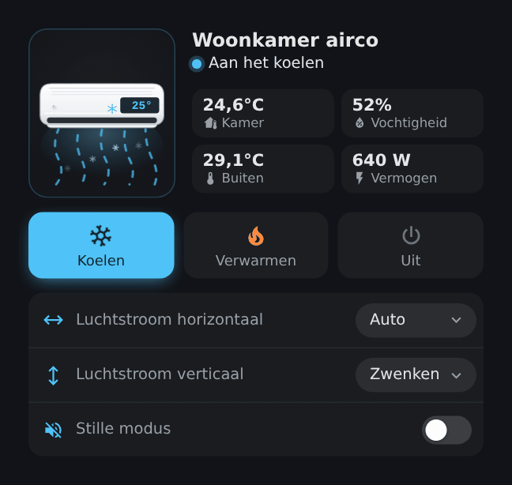
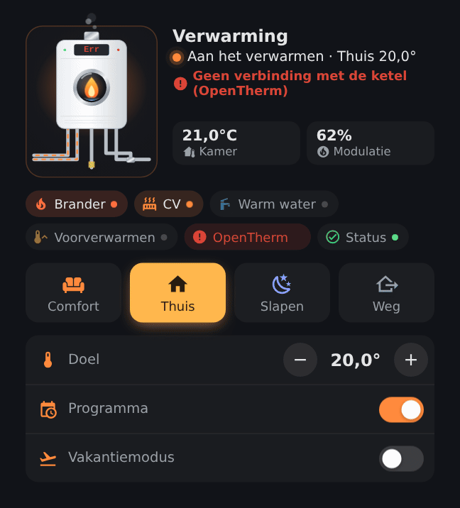
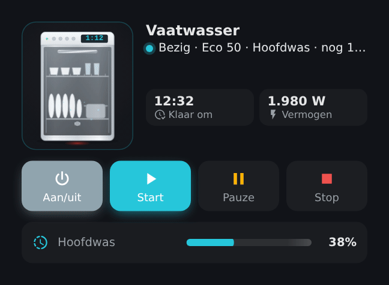
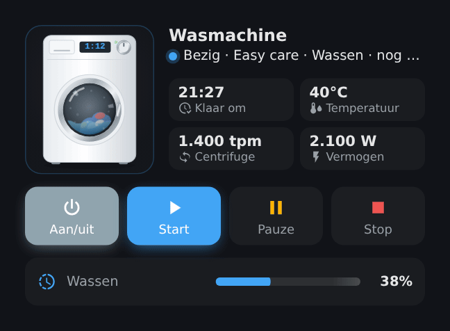
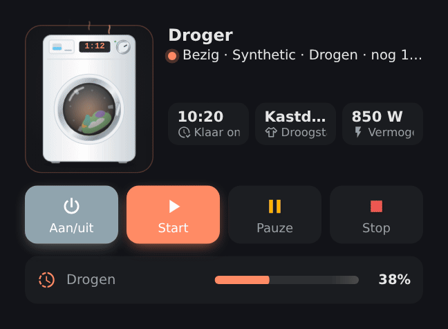
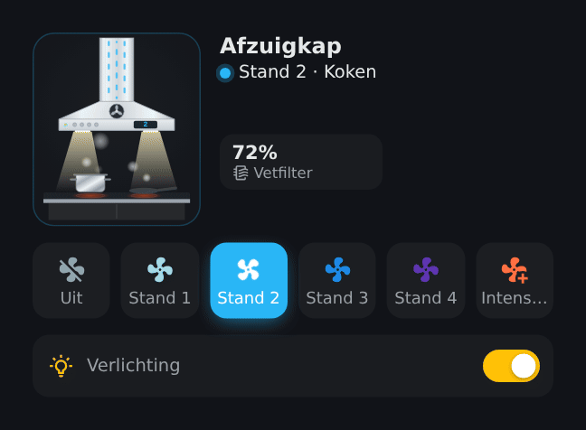
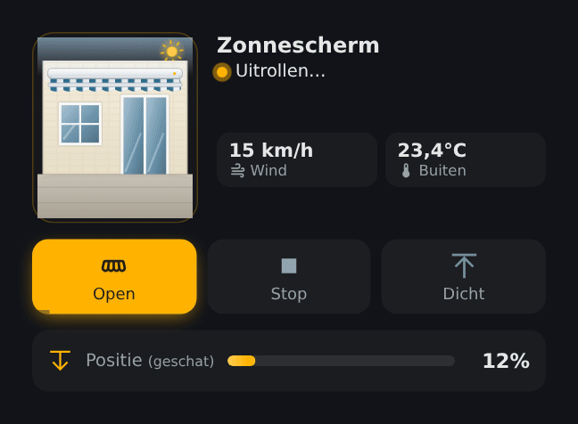
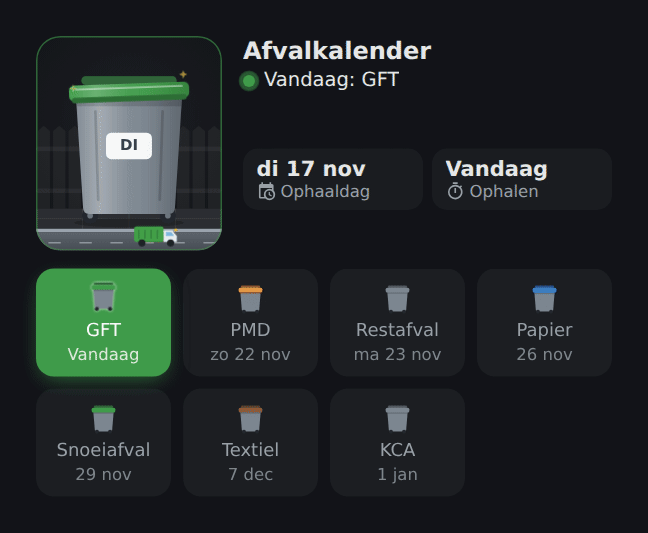
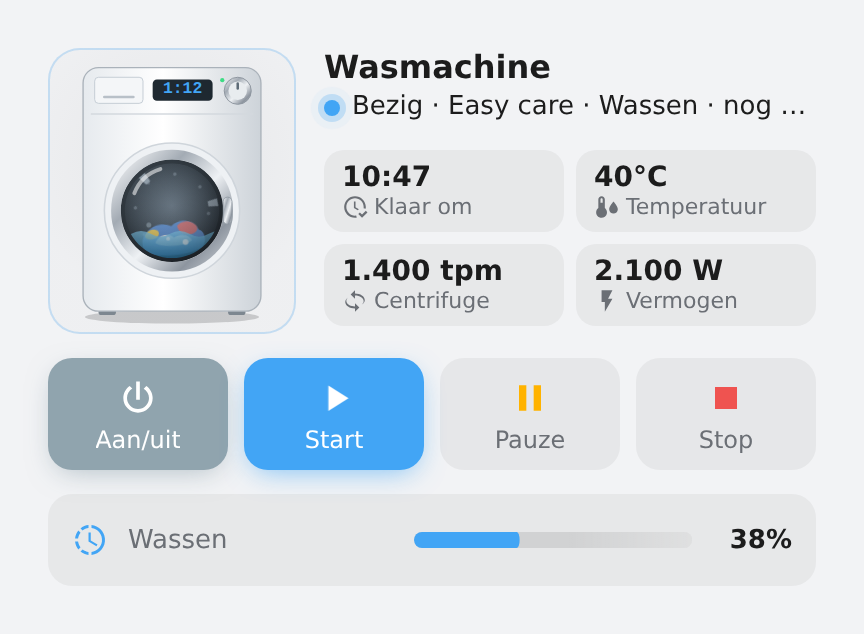

# HA Animated Appliance Cards

Animated, consistent Home Assistant dashboard cards for the appliances in your house, each with a drawn illustration that moves with the real device, a full visual editor, and Dutch + English labels.

| | |
|:---:|:---:|
| **Air conditioner** · [docs](docs/cards/aircon-card.md)  | **Central heating** (Toon) · [docs](docs/cards/heating-card.md)  |
| **Dishwasher** · [docs](docs/cards/dishwasher-card.md)  | **Washing machine** · [docs](docs/cards/washer-card.md)  |
| **Dryer** · [docs](docs/cards/dryer-card.md)  | **Extractor hood** · [docs](docs/cards/hood-card.md)  |
| **Awning** (zonnescherm) · [docs](docs/cards/awning-card.md)  | **Waste collection** (afvalkalender) · [docs](docs/cards/waste-card.md)  |
| **Light theme**  | |

| Card | Works with |
|---|---|
| `custom:aircon-card` | IR scripts (cool / heat / off) or any `climate` entity |
| `custom:heating-card` | Toon (Eneco) or any `climate` entity, plus boiler sensors |
| `custom:dishwasher-card`, `custom:washer-card`, `custom:dryer-card` | Home Connect, Miele, LG, Samsung… (operation-state sensor), or just a smart plug's power sensor |
| `custom:hood-card` | A `fan` entity (stages + intensive), a `select` with stages (Home Connect), an `input_select` with off/low/medium/high, or a switch; light, cooktop and grease-filter sensors |
| `custom:awning-card` | Open / stop / close scripts with an open/closed sensor, or a `cover` |
| `custom:waste-card` | The [Afvalwijzer](https://github.com/xirixiz/homeassistant-afvalwijzer) integration (one date sensor per waste type), or any sensor holding a collection date |

## Install with HACS (recommended)
1. **HACS → ⋮ → Custom repositories**, add this repository's URL, type **Dashboard**.
2. Search for **HA Animated Appliance Cards**, download, and reload the browser.
3. HACS adds one resource, `/hacsfiles/ha-cards/ha-cards.js`, which contains all the cards.
4. Add a card from the card picker and set it up in the visual editor.

If you previously installed a card by hand (`/local/<name>-card.js`), **remove that resource** first: the same card can't be loaded twice.

## Install by hand
1. Copy `cards/<name>-card.js` to `/config/www/`.
2. **Settings → Dashboards → ⋮ → Resources → Add resource** → `/local/<name>-card.js?v=1`, type *JavaScript module*.
3. Hard-refresh, then add the card from the card picker and set it up in the visual editor.
4. After updating the file, raise the `?v=` number.

## Develop
See [docs/design-system.md](docs/design-system.md) and [docs/testing.md](docs/testing.md).
Open `preview/*.html` in a browser to try the cards without Home Assistant.

The images above are made by `tools/capture.py` from the preview pages; the Screenshots workflow regenerates them whenever a card changes.

Each card is a single plain-JS file in `cards/`. For HACS, `npm run build` concatenates them into `dist/ha-cards.js`. To release, bump `version` in `package.json` and push a matching tag (`git tag v1.0.1 && git push origin v1.0.1`). The Release workflow builds the bundle, creates the GitHub release and attaches `ha-cards.js`.

## License
[MIT](LICENSE). The air-conditioner illustration is adapted from [skyrotter/ha-appliance-electromenager-cards](https://github.com/skyrotter/ha-appliance-electromenager-cards) (MIT); see [THIRD_PARTY_NOTICES.md](THIRD_PARTY_NOTICES.md).
