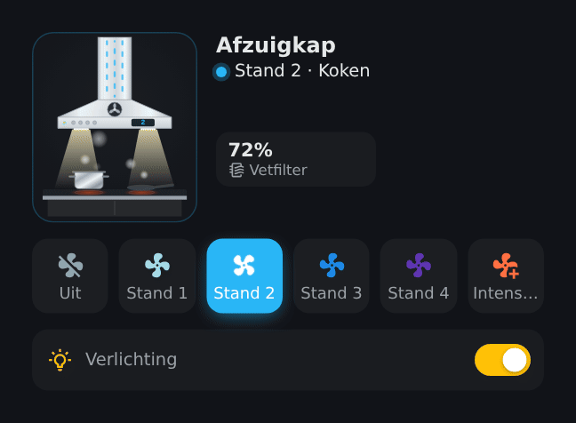

# hood-card



Animated cooker / extractor hood ("afzuigkap") card for Home Assistant, in the same style as the other cards. Works with a `fan` entity (speed stages and presets such as *intensive*), a `select` with stage options (Home Connect hoods), or a plain `switch`.

What it shows:
- **Illustration.** A chimney hood above a cooktop. While the fan runs, the fan in the canopy turns and air streams up the chimney, faster for higher stages and fastest on intensive. With a cooktop sensor, the cooking zones glow and steam rises from the pans; while the fan runs, the steam is pulled into the hood. The light under the hood casts two beams when it's on. The display shows the stage, "P" for intensive or "A" for auto.
- **Status line.** Uit / Stand 1…N / Intensief / Verlichting aan, plus "Koken" while the cooktop is on.
- **Warning.** "Vetfilter reinigen" when the grease filter is saturated.
- **Tiles.** Grease-filter saturation (%) and power. Unknown values are hidden.
- **Buttons.** Uit, Stand 1…N and the presets. With a `fan` entity they come from its speed steps (`percentage_step`) and `preset_modes`; with a `select`, one button per option (off, stages and intensive are recognised).
- **Controls.** A light switch, shown when a light is configured.

## Install

With HACS this card is part of **HA Animated Appliance Cards**. By hand: copy `hood-card.js` to `/config/www/`, add `/local/hood-card.js?v=1` as a *JavaScript module* resource and hard-refresh. Then **Add card → "Extractor hood card"**.

## Examples

```yaml
type: custom:hood-card
name: Afzuigkap
entity: fan.afzuigkap               # 4 stages from percentage_step: 25, plus the "intensive" preset
light: light.afzuigkap
cooktop: sensor.kookplaat_vermogen  # power sensor (> 50 W = cooking), or a binary_sensor / switch
filter: sensor.afzuigkap_vetfilter  # % saturation, warning at 100 %
```

```yaml
type: custom:hood-card
entity: select.hood_venting_level   # Home Connect: one button per stage option
light: light.hood_functional_light
```

Own buttons (YAML only):

```yaml
buttons:
  - off: true
  - stage: 1
  - stage: 3
  - preset: intensive
  - name: Na-ventileren
    icon: mdi:timer-outline
    action: perform-action
    perform_action: script.afzuigkap_nalopen
```

## Options

| Option | Description |
|---|---|
| `entity` | `fan`, `select`/`input_select` with stage options, or `switch`/`input_boolean` |
| `stages` | Number of stages for a `fan` (default: from `percentage_step` or `speed_count`, else 3) |
| `show_off`, `show_presets` | Show the Uit button / the preset buttons (default: both) |
| `light` | `light` or `switch`: light row in the controls panel and the beams in the drawing |
| `cooktop`, `cooktop_threshold` | Cooktop sensor or switch; a numeric sensor counts as cooking above the threshold (default 50 W) |
| `filter`, `filter_alert` | Grease filter: a % sensor (tile, warning from `filter_alert`, default 100) or a problem-style sensor (warning only) |
| `power`, `show_power` | Power sensor shown as a tile |
| `columns`, `hide_buttons` | Layout |
| `buttons` | YAML only: own buttons, each `{off: true}`, `{stage: n}`, `{preset: name}`, `{option: value}` or a custom `action`, with optional `name`, `icon`, `color` |
| `tiles` | YAML only: extra tiles, as in aircon-card |
| `tap_action` | Action when tapping the illustration (default: more-info) |

Everything except `buttons`, `tiles` and custom actions can be set in the visual editor.
