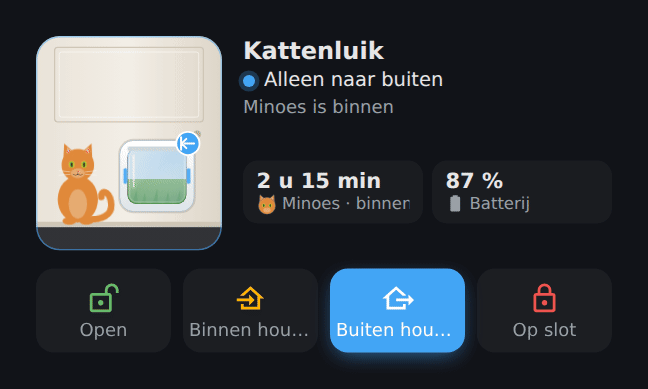

# petflap-card



Animated pet / cat flap ("kattenluik") card for Home Assistant, in the same style as the other cards. Made for the [Sure Petcare](https://www.home-assistant.io/integrations/surepetcare/) integration (SureFlap Connect cat flap and pet flap).

What it shows:
- **Illustration.** The flap in your door, seen from inside, with the garden through its window.
  - **Cat inside:** it sits next to the flap in the fur colour you pick, swishing its tail and blinking.
  - **Cat outside:** paw prints lead to the flap.
  - **Going through:** when the cat goes in or out, the flap swings and the cat walks through it.
  - **Lock mode:** a badge on the flap shows the current mode. The flap's latches light up when it's restricted, and it turns red when it's locked.
- **Status line.** The lock mode ("Open in beide richtingen", "Alleen naar binnen", "Alleen naar buiten", "Op slot", or "Offline"), with "Minoes is binnen" underneath.
- **Warnings.** "Kattenluik offline" when the flap loses its connection, and "Batterij bijna leeg" from 20 % down.
- **Tiles.** How long the cat has been inside or outside ("2 u 15 min" · "Minoes · binnen"), and the battery level.
- **Buttons.** The four lock modes: **Open**, **Binnen houden** (the cat can come in but not go out), **Buiten houden** (the cat can go out but not come in) and **Op slot**. The current mode is filled in. With `read_only: true` the buttons only show the mode.
- **More than one pet.** The drawing shows the first pet, and one row per pet under the buttons shows who is inside or outside and since when.

## How the lock mode works

Sure Petcare creates three lock entities per flap: `lock.<flap>_locked_in`, `lock.<flap>_locked_out` and `lock.<flap>_locked_all`. Only the one matching the current mode reports *locked*; when all three are *unlocked*, the flap is open.

The card works the same way. Pressing **Binnen houden** calls `lock.lock` on the locked-in entity, and **Open** calls `lock.unlock` on whichever one is locked. If you set `flap_id`, the card uses `surepetcare.set_lock_state` instead.

## Install

With HACS this card is part of **HA Animated Appliance Cards**. By hand: copy `petflap-card.js` to `/config/www/`, add `/local/petflap-card.js?v=1` as a *JavaScript module* resource and hard-refresh. Then **Add card → "Pet flap card"**. The card fills in the flap's locks, battery, connectivity and every Sure Petcare pet it finds; pick the fur colour in the visual editor.

## Example

```yaml
type: custom:petflap-card
name: Kattenluik
locked_in: lock.kattenluik_locked_in
locked_out: lock.kattenluik_locked_out
locked_all: lock.kattenluik_locked_all
battery: sensor.kattenluik_battery_level
connectivity: binary_sensor.kattenluik_connectivity
pets:
  - entity: binary_sensor.minoes   # Sure Petcare pet: on = inside
    color: ginger                  # black, grey, ginger, brown, cream, white, or a #hex colour
```

## Options

| Option | Description |
|---|---|
| `locked_in`, `locked_out`, `locked_all` | The flap's three lock entities. A mode's button only appears when its entity is set; Open appears when at least one is set |
| `flap_id` | Optional: the Sure Petcare flap id, to switch modes with `surepetcare.set_lock_state` instead of the lock entities |
| `pets` | List of pets, each with `entity` (presence binary_sensor, on = inside, attribute `since`), and optionally `name` and `color` (fur) |
| `battery`, `battery_alert`, `show_battery` | Battery sensor, warning threshold (default 20 %), and whether to show the battery tile (default `true`) |
| `connectivity` | Flap connectivity sensor: "Offline" status and warning when it's off |
| `columns`, `hide_buttons`, `read_only` | Layout; `read_only: true` makes the buttons show the mode without doing anything |
| `tap_action` | Action when tapping the illustration (default: more-info of the first pet) |

Everything except `tap_action` can be set in the visual editor.
