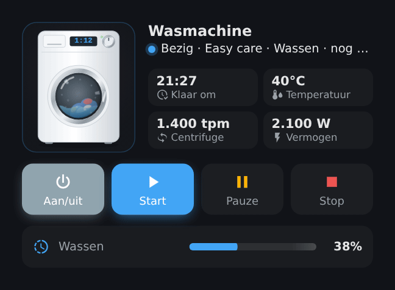

# washer-card



Animated washing-machine card for Home Assistant, in the same style as the other cards. Works with **Home Connect** (Bosch, Siemens, Neff…), **Miele**, LG, Samsung and other integrations through their *operation state* sensor, or with nothing more than a **smart plug** that measures power.

What it shows:
- **Illustration.** A front-loader. While washing, the drum turns back and forth, the laundry sloshes and water with bubbles moves behind the glass; during spinning the drum spins fast and the machine shakes. The porthole door swings open when the door is open. The display shows the time left, "End" when finished or "Err" on a fault; the power LED blinks while paused or on a fault.
- **Status line.** Uit / Gereed / Uitgestelde start / Bezig / Gepauzeerd / Actie vereist / Klaar / Storing, plus the program, the phase and the time left ("nog 1 u 12 min"). "Deur open" is added when the door is open and nothing is running.
- **Warnings.** "Wasmiddel bijna op" and "Wasverzachter bijna op" (i-Dos) in red under the status.
- **Tiles.** "Klaar om" (finish time) while running, temperature, spin speed, power and energy. Unknown values are hidden.
- **Buttons.** Aan/uit, Start, Pauze (becomes **Hervatten** while paused) and Stop; only the ones you configure appear. Buttons that can't be used right now are dimmed instead of hidden, so the layout doesn't jump.
- **Controls.** While idle: a program picker (when the program is a `select`). While running: a progress bar with the phase and percentage.

## Install

With HACS this card is part of **HA Animated Appliance Cards**. By hand: copy `washer-card.js` to `/config/www/`, add `/local/washer-card.js?v=1` as a *JavaScript module* resource and hard-refresh. Then **Add card → "Washer card"**; the card pre-fills the entities it can find, check them in the visual editor.

## Example (Home Connect)

Entity ids differ per installation and integration version; check yours under Settings → Devices.

```yaml
type: custom:washer-card
state_entity: sensor.wasmachine_operation_state
power_switch: switch.wasmachine_power
program: select.wasmachine_selected_program
remaining: sensor.wasmachine_program_finish_time
progress: sensor.wasmachine_program_progress
door: binary_sensor.wasmachine_door
start: select.wasmachine_active_program    # selecting the chosen program here starts it
pause: button.wasmachine_pause_program
resume: button.wasmachine_resume_program
stop: button.wasmachine_stop_program
temperature: select.wasmachine_temperature
spin: select.wasmachine_spin_speed
detergent: sensor.wasmachine_i_dos_1_fill_level_poor
```

## Example (smart plug only)

```yaml
type: custom:washer-card
power: sensor.wasmachine_plug_power
power_threshold: 5    # watts; above this the appliance counts as running
```

## Options

| Option | Description |
|---|---|
| `state_entity` | Operation state (`sensor`, `select` or `binary_sensor`). Home Connect, Miele and most others are recognised; see `state_map` |
| `power_switch` | Switch for the Aan/uit button; when it's off the card shows "Uit" |
| `program`, `phase` | Program (`select` → picker in the card, or `sensor`) and program phase |
| `remaining` | Time left: a timestamp sensor (finish time, Home Connect), a duration in min/h/s (Miele) or `h:mm` |
| `progress` | Progress in %. Without it, the card estimates progress from the remaining time |
| `door` | `binary_sensor` (on = open) or a sensor reporting open/closed |
| `start`, `pause`, `resume`, `stop` | A `button`, `script`, `scene`, `switch` or `automation` (pressed according to its domain), a `select` (selects the current program: Home Connect's *active program*), or a full HA action object (YAML) |
| `power`, `power_threshold`, `energy` | Power sensor (tile, and the running state when there's no `state_entity`; default threshold 5 W) and energy sensor |
| `temperature`, `spin` | Tiles for the chosen temperature and spin speed (`select` or `sensor`) |
| `detergent`, `softener` | Sensors that report low detergent / softener |
| `show_finish`, `show_power`, `show_program_select`, `hide_buttons` | Layout |
| `state_map` | YAML only: map your integration's raw states to `off`, `idle`, `delayed`, `running`, `paused`, `action`, `finished` or `error`, e.g. `state_map: { "Bezig": running }` |
| `tiles` | YAML only: extra tiles, as in aircon-card |
| `tap_action` | Action when tapping the illustration (default: more-info) |

Everything except `state_map`, `tiles` and custom actions can be set in the visual editor. Progress without a sensor is remembered per browser (localStorage).
