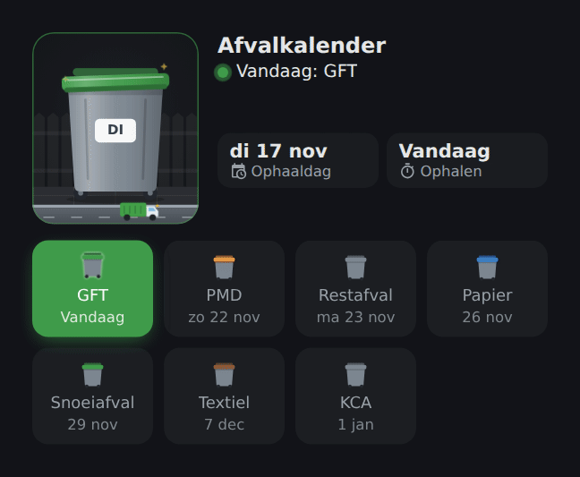

# waste-card



Animated waste-collection card ("afvalkalender") for Home Assistant, in the same style as the other cards. Made for the [Afvalwijzer](https://github.com/xirixiz/homeassistant-afvalwijzer) integration, which creates one sensor per waste type (`sensor.afvalwijzer_gft`, `_pmd`, `_papier`, `_restafval`, …) whose state is the next collection date. Any other sensor that holds a date works too.

What it shows:
- **Illustration.** Your next container on the pavement, in your own container and lid colours, with the collection weekday on its sticker.
  - **Today:** the lid flips open and the garbage truck drives past.
  - **Tomorrow:** the container rocks as if it's being rolled to the kerb, with arrows pointing to the street.
  - **Two types on the same day:** two containers side by side. More than two adds a "+1" badge.
- **Status line.** "Vandaag: GFT", "Morgen: PMD · vanavond buitenzetten", "Over 4 dagen: Restafval", or "Geen ophaaldagen gepland".
- **Warning.** The latest message from your waste collector (Afvalwijzer `notifications` sensor), for example a changed collection day around a holiday.
- **Tiles.** The collection day ("wo 18 nov") and how long until then.
- **Containers.** One button per waste type, soonest first, each with a mini container in its colours and when it's collected next: "Vandaag" (filled), "Morgen" (outlined), the weekday within a week, otherwise the date. Tapping a button opens that sensor.

Dates are counted in your browser's time zone, and the card redraws itself at midnight.

## Install

With HACS this card is part of **HA Animated Appliance Cards**. By hand: copy `waste-card.js` to `/config/www/`, add `/local/waste-card.js?v=1` as a *JavaScript module* resource and hard-refresh. Then **Add card → "Waste collection card"**. It pre-fills every Afvalwijzer waste sensor it finds; set the colours in the visual editor.

## Example

```yaml
type: custom:waste-card
name: Afvalkalender
notifications: sensor.afvalwijzer_notifications
max_days: 31                   # hide containers that are further away (optional)
bins:
  - entity: sensor.afvalwijzer_gft
    color: gray                # container: gray, green, brown, blue or orange (or a #hex colour)
    lid: green                 # lid: same choices
  - entity: sensor.afvalwijzer_pmd
    lid: orange
  - entity: sensor.afvalwijzer_papier
    color: blue
    lid: blue
  - entity: sensor.afvalwijzer_restafval
  - entity: sensor.afvalwijzer_snoeiafval
    name: Tuinafval
    color: brown
    lid: brown
```

Default colours per waste type (used when `color` / `lid` are left out):

| Waste type (from the entity id) | Name (nl / en) | Container | Lid |
|---|---|---|---|
| `gft` | GFT / Organic | green | green |
| `pmd`, `plastic` | PMD | grey | orange |
| `papier` | Papier / Paper | blue | blue |
| `restafval` | Restafval / Residual | grey | grey |
| `textiel` | Textiel / Textiles | grey | brown |
| `kca` | KCA / Chemical waste | grey | grey |
| `snoeiafval`, `tuin` | Snoeiafval / Pruning waste | brown | green |
| `glas` | Glas / Glass | green | grey |
| `kerstbomen` | Kerstbomen / Christmas trees | green | brown |

## Options

| Option | Description |
|---|---|
| `bins` | List of containers, each with `entity` (date sensor), and optionally `name`, `color` and `lid` |
| `notifications` | Afvalwijzer notifications sensor (count + `notifications` attribute): shows the latest message as a warning |
| `max_days` | Only show containers collected within this many days (default: all) |
| `show_empty` | Also show containers without a date ("geen"), dimmed (default `false`) |
| `show_tiles` | `false` hides the date tiles; the date then goes under the status line (default `true`) |
| `columns` | Containers per row (default: up to 4) |
| `hide_bins` | Hide the container buttons |
| `tap_action` | Action when tapping the illustration (default: more-info of the next container) |

Accepted sensor states: `2026-11-20`, a full timestamp (Afvalwijzer's *show full timestamp* option), or `20-11-2026` (the README's "formatted" template sensors). Anything else (`geen`, `unknown`) counts as "no date".

Everything except `tap_action` can be set in the visual editor.
